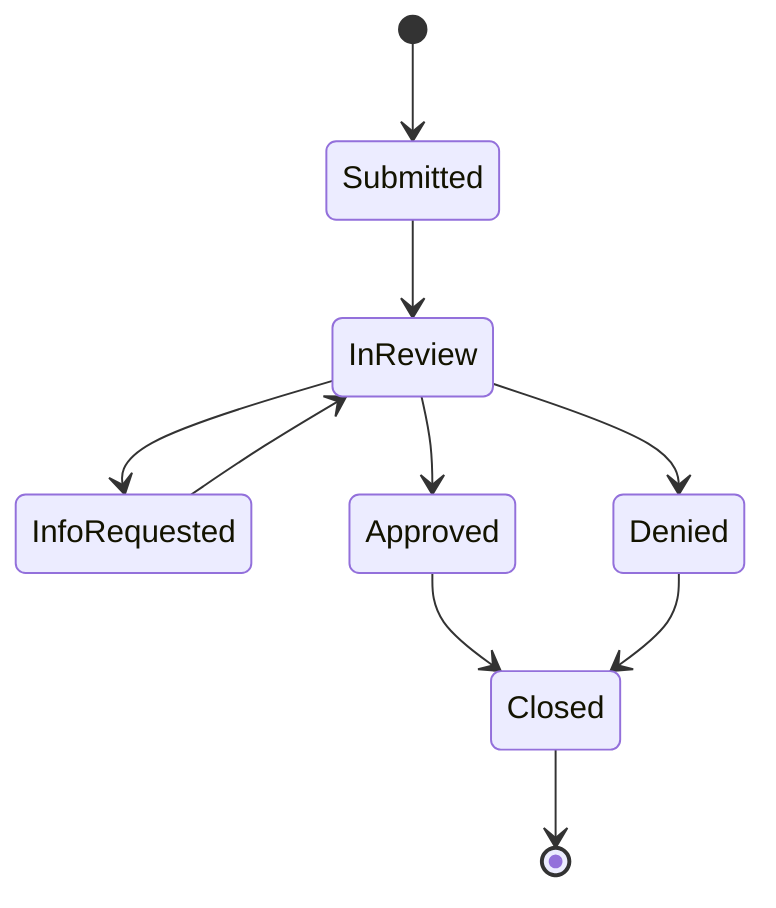

# OneCover

A full-stack employee benefits app, modeled on group disability and leave workflows. Members enroll in coverage, file disability leave claims, and follow them through review. Admins manage plans, work the claims queue, and record payments.

Built as a portfolio project in a .NET full-stack training program.

## Features

**Members**
- Register and log in (JWT)
- Browse coverage plans and enroll. The first premium bill is created automatically.
- File a disability leave claim with a 3-step form. The weekly and total benefit are calculated by the server.
- Track each claim's status with a full history timeline (who changed it, when, and why)
- View statements (premiums owed and benefits paid)
- Profile with a masked SSN (`***-**-1234`) and an FMLA eligibility check

**Admins**
- Dashboard of claim counts by status. Each card opens the queue filtered to that status.
- Claims queue with a status filter and server-side paging
- Claim review: move a claim through the workflow with a note. Only valid next steps are offered.
- Payments: mark pending payments Paid or Failed
- Plans: add, edit, and retire (soft delete)

## Tech stack

| Layer | Technology |
|---|---|
| API | ASP.NET Core Web API (.NET 10), controllers → services → repositories |
| Data | EF Core 10 (code-first migrations), SQL Server |
| Auth | JWT bearer tokens, role-based authorization (Member / Admin), hashed passwords |
| Front end | Angular 22 (standalone components, signals), Angular Material, reactive forms |
| Testing | xUnit (API business rules), Vitest (Angular), Postman collection |
| Docs | OpenAPI + Swagger UI (development) |

## Running locally

**Prerequisites:** .NET 10 SDK, SQL Server on `localhost` with Windows authentication (Developer or Express edition), Node.js with npm, and the EF Core CLI (`dotnet tool install --global dotnet-ef`).

1. **Set the JWT signing key.** It's the only secret, and it stays out of source control:
   ```
   cd api/OneCover.Api
   dotnet user-secrets set "Jwt:Key" "<any random string of 32+ characters>"
   ```
2. **Create the database and start the API:**
   ```
   dotnet ef database update
   dotnet run
   ```
   The API runs at `http://localhost:5173`. In Development it seeds 5 plans and 3 users on first start. Swagger UI is at `http://localhost:5173/swagger`.
3. **Start the front end** in a second terminal:
   ```
   cd web
   npm install
   npx ng serve
   ```
   Open `http://localhost:4200`.

**Demo logins** (password `Demo123!` for all three, seeded in Development only):

| Email | Role | Notes |
|---|---|---|
| `admin@onecover.dev` | Admin | |
| `member@onecover.dev` | Member | Hired 3 years ago, 1,800 hours: FMLA eligible |
| `newhire@onecover.dev` | Member | Hired 6 months ago, 900 hours: not FMLA eligible |

The connection string in `appsettings.Development.json` uses Windows authentication, so it contains no password and is safe to commit.

## Business rules

**Disability benefit (STD/LTD)**
- Weekly benefit = annual salary ÷ 52 × the plan's benefit percent, capped at the plan's weekly maximum. Example: $78,000 ÷ 52 × 60% = **$900/week** (under the $1,500 STD cap).
- Total benefit = (weekly ÷ 7) × payable days. The first *elimination period* days of a leave aren't paid (7 days for STD, 90 for LTD).
- Amounts are calculated **only on the server**, once, when the claim is submitted. The request has no amount fields, and a claim keeps the terms it was filed under even if the plan changes later.

**Claims**
- Claims are disability leaves, so they can only be filed against **active STD or LTD** coverage.
- The leave can't end before it starts or begin before coverage did, and a single claim can't cover more than one year.

**FMLA eligibility:** at least 12 months since the hire date **and** at least 1,250 hours worked in the last 12 months.

**Claim workflow.** Only these moves are allowed. Every move writes a history row, and approving a claim creates a pending benefit payment in the same transaction.



**Security**
- Members only ever see their own data. The user id comes from the JWT, never from the URL or request body. Someone else's record returns 404, so the API never confirms that it exists.
- Only the last 4 digits of the SSN are stored.
- The UI hides what a role can't do, but the API enforces every rule on its own.

## Architecture

```
Angular (pages → services → HttpClient + JWT interceptor)
        │  JSON over HTTP
ASP.NET Core API
  Controllers   thin: HTTP only, return DTOs (never entities)
  Services      business rules + coordination (ClaimService, BenefitCalculator, EligibilityService…)
  Entities      rich domain model: BenefitClaim.Submit / MoveTo and Payment.MarkPaid protect their own rules
  Repositories  EF Core data access
        │
SQL Server
```

- **One error format:** every error is an RFC 9457 ProblemDetails response, produced by one global exception handler. The front end turns any error into a readable message with one helper.
- **Dependency injection throughout:** services depend on interfaces, and "today" comes from an injected `TimeProvider`, so date rules are testable.

## Tests

```
cd api && dotnet test        # xUnit: claim workflow, entity rules, benefit math, FMLA, payments, plans
cd web && npx ng test        # Vitest: SSN pipe, date validators, AuthService (login, token restore, expiry), app shell + role nav
```

The business rules live in plain classes and entities, so the xUnit tests need no database. A Postman collection covering every endpoint is in `postman/OneCover.postman_collection.json`.

## Database design

- **Normalized, with one deliberate exception.** Users, plans, enrollments, claims, claim history and payments each have their own table, so each fact lives in one place. `Enrollment` is the join between users and plans (many-to-many), with its own data (start date, status). Claim history is its own table because one claim has many status changes. The exception: `BenefitClaim` and `Payment` also carry a `UserId`, even though the member could be reached through the enrollment. Ownership checks ("only your own claims") are the most common query, and this keeps them a simple filter instead of a join.
- **`Payment` has two nullable foreign keys** (`EnrollmentId`, `ClaimId`). A premium pays for an enrollment, and a benefit pays out a claim. A **CHECK constraint** guarantees that every payment links to exactly one of them. This keeps one payments table (one statement query) instead of two near-identical tables.
- **Claim history is append-only.** The C# properties are `init`-only, and a SQL Server trigger rejects updates and deletes even from outside the app. Both the constraint and the trigger are created by EF migrations, so a rebuilt database always has them.
- **Other database rules:** a filtered unique index (one *active* enrollment per member per plan), restricted deletes (financial records are never cascade-deleted), enums stored as readable strings, and money as `decimal(18,2)`.

## Known limitations

- **Concurrency:** two admins approving the same claim at the same instant could both succeed. The fix is optimistic concurrency (a `rowversion` column, with a 409 for the second save).
- **Token storage:** the JWT lives in `localStorage`. Production apps often prefer an `HttpOnly` cookie, which JavaScript can't read.
- The admin payments list isn't paged yet, and retired plans can't be reactivated.

## How AI was used

This project was built with Claude Code as a tutor and pair programmer. I hand-coded the data model, the claim entity and its workflow, and the Angular pages. AI drafted repetitive layers (DTOs, repositories, controllers) once I had hand-coded each pattern, and near the deadline it also drafted some business logic and tests, which I reviewed and can explain. Every pull request went through an automated AI code review, and the fixes were triaged rather than applied blindly. Details, including mistakes the AI made and how they were caught: [`docs/AI_USAGE.md`](docs/AI_USAGE.md). Business requirements: [`docs/BRD.md`](docs/BRD.md).

## Live demo

Not deployed yet. Azure App Service + Azure SQL is the next step.
